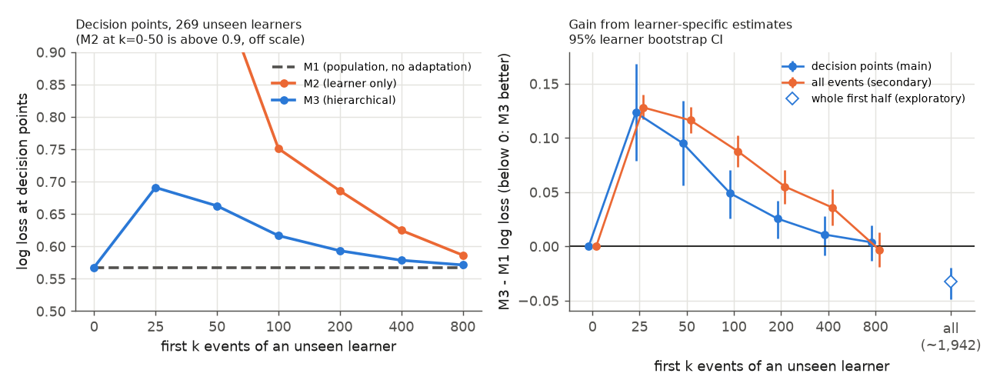

# 副評価：未知学習者の適応曲線（本番サンプル）

- 実行日：2026-10-22
- 手順：`reports/evaluation_protocol.md` の9節（本番の結果を見る前にコミット、`7f8fdac`）
- 実装：`src/adaptation.py`（事前登録した手順）、`src/adaptation_explore.py`（探索的な確認）、図は `src/plot_adaptation.py`

## 結論
1. **未知の学習者に、最初の数百行動だけで個人差を当てはめると、予測はかえって悪くなる。**
   - 決定点の Log Loss は、全体モデル M1 が 0.568。M3 は、k=25 で 0.691、k=100 で 0.617、k=400 で 0.579 と、どの k でも M1 を下回らなかった。
   - k=25〜200 では、M3 は M1 よりはっきり悪い（95%区間が0を含まない）。
2. **800行でようやく M1 と同じくらいになり、前半をすべて使うと M1 より良くなる。**
   - k=800 の M3−M1 は +0.004（区間 −0.013〜+0.019）。
   - 前半をすべて使う（中央値 1,942行、探索的）と −0.033（区間 −0.049〜−0.020）。主評価と同じ大きさの改善になった。
3. **原因は、最初の行動が「実力診断」で、その後の学習とは違う動きをすること（と考えられる）。**
   - 前半の最初の25行は、83%が diagnosis の行だった（25〜100行目は 7%、100行目以降はほぼ0%、後半は0%）。
   - diagnosis では提出の後に解説がほとんど出ない（D2）。そのため、最初の行動から学んだ個人差は、後の学習の予測に合わない。
4. **学習者別だけのモデル（M2）は、どの k でも M3 より悪い。** 部分プーリング（M3）が、少ないデータでの悪化を小さく抑えている。

## 1. 対象
| 段階 | 人数・件数 |
|---|---|
| D7 を満たす学習者（主評価の対象） | 1,632人 |
| 未知の学習者（`default_rng(4)` で半分） | 816人 |
| うち前半が800行以上（評価対象） | 269人 |
| 評価する決定点 / 全イベント（後半） | 133,142件 / 785,611件 |
| 全体モデル（M0・M1・κ）の推定に使った行（未知の学習者を除く） | 1,792,851行 |

- 評価対象は、前半が800行以上ある、よく使う学習者に限られる。どの k でも同じ行を評価するため（手順書9節）。

## 2. 結果

決定点（主）の Log Loss
| k | M1 | M2 | M3 | M3−M1 [95%区間] | M3−M2 [95%区間] |
|---|---|---|---|---|---|
| 0 | 0.568 | 1.703 | 0.568 | 0.000 | −1.135 [−1.180, −1.085] |
| 25 | 0.568 | 1.801 | 0.691 | **+0.123** [+0.079, +0.168] | −1.110 [−1.223, −0.998] |
| 50 | 0.568 | 1.010 | 0.663 | **+0.095** [+0.056, +0.134] | −0.347 [−0.403, −0.298] |
| 100 | 0.568 | 0.751 | 0.617 | **+0.049** [+0.026, +0.071] | −0.134 [−0.159, −0.113] |
| 200 | 0.568 | 0.686 | 0.593 | **+0.026** [+0.007, +0.042] | −0.092 [−0.113, −0.074] |
| 400 | 0.568 | 0.625 | 0.579 | +0.011 [−0.008, +0.028] | −0.046 [−0.063, −0.032] |
| 800 | 0.568 | 0.586 | 0.571 | +0.004 [−0.013, +0.019] | −0.015 [−0.021, −0.010] |
| 前半すべて（探索的） | 0.568 | 0.535 | 0.535 | **−0.033** [−0.049, −0.020] | — |

全イベント（副）の M3−M1
| k | 0 | 25 | 50 | 100 | 200 | 400 | 800 |
|---|---|---|---|---|---|---|---|
| M3−M1 | 0.000 | +0.128 | +0.116 | +0.088 | +0.055 | +0.036 | −0.003 |
| 95%区間 | — | [+0.117, +0.140] | [+0.105, +0.129] | [+0.073, +0.103] | [+0.039, +0.070] | [+0.020, +0.053] | [−0.019, +0.013] |

正解率（決定点）
- M1 は 0.842。M3 は k=25 で 0.709、k=100 で 0.820、k=200 以降は 0.838〜0.841。
- k=25〜100 では M1 よりはっきり低く、k=200 以降は差の区間が0を含む。

## 3. 探索的な確認（事前登録の外）
手順書9節の k の範囲（最大800）では M3 の利点が見えなかった。そこで、結果を見た後に次の2つを確かめた。どちらも手順を変えるものではない。

- **前半をすべて使った場合**：同じ269人で、前半すべて（中央値 1,942行）を適応に使うと、M3 0.535、M1 0.568、M3−M1 −0.033 [−0.049, −0.020]。主評価（`reports/main_results.md`）の差（−0.032）とほぼ同じ。
- **最初の行の source**：前半の 0〜25行目の 83.2%、25〜100行目の 7.2%、100〜400行目の 0.1% が diagnosis。後半は 0%。

## 解釈（推測を含む）
- **個人差を使うには、ある程度の量のデータが必要。** 個人差を予測に生かすには、800行（数セッション分）より多くのデータが必要だった。主評価で M3 が M1 を上回ったのは、評価対象の学習者に前半だけで平均して数千行のデータがあったから、と考えられる。
- **最初の行動は代表的でない。** 学習者の最初の行動の多くは実力診断で、その後の通常の学習とは流れが違う。最初の行動から個人差を推定すると、後の学習の予測を誤らせる。
- **シミュレーションへの示唆**
  - 新しい学習者は、しばらく全体モデル（M1）で表すのが安全。
  - 個人差を入れるのは、通常の学習のデータがたまってからにするのがよい。
- **改善の候補**（今回は行っていない。行う場合は、手順書に追記してから）
  - 適応に使うデータから diagnosis の行を除く。
  - 学習の段階（診断中かどうか）を状態に含める。

## 限界
- 評価対象は、前半が800行以上ある269人だけ。データの少ない学習者でどうなるかは、この評価では分からない。
- 「前半すべて」の点は、結果を見た後の確認（探索的）。事前登録した結論は、「k≦800 では M3 は M1 を上回らない」まで。
