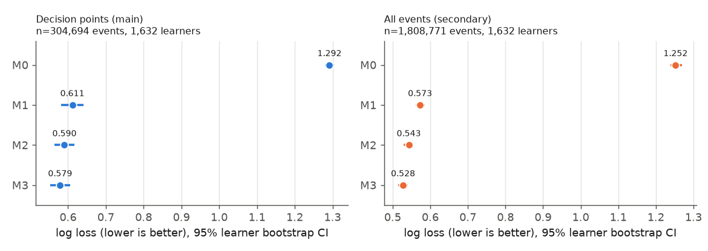

# 本番の結果：M0〜M3 による次の行動の予測と再現（EdNet KT4、10,000人のサンプル）

- 実行日：2026-10-22
- 手順：`reports/evaluation_protocol.md`（本番の前にコミットで固定、`62e4286`。変更は末尾の変更履歴の1件だけで、結果を見る前のもの）
- 実装：`src/pipeline.py`、`src/evaluate.py`、`src/sample_main.py`、図は `src/plot_main_results.py`
- 出力（git 管理外）：`data/processed/main_eval/`

## 結論
1. **学習者ごとの違いを入れると、決定点での次の行動の予測がよくなる**
   - 主評価（決定点、1,632人・304,694件）の Log Loss は、M1（全体）0.611 → M2（学習者別）0.590 → M3（階層）0.579。
   - M3 は M1 より 0.032 低い（95%区間 −0.048〜−0.019）。M2 より 0.011 低い（−0.016〜−0.008）。どちらも学習者単位のブートストラップで、区間が0を含まない。
2. **ただし、改善は確率の精度だけで、当たり外れはほとんど変わらない**
   - Accuracy（約0.823）と Macro-F1（約0.41）は、M1・M2・M3 でほぼ同じだった（差の区間が0を含む、または差が0.001程度）。
   - 決定点の次の行動の大半は「次の問題」で（65%）、どのモデルもまずそれを予測する。学習者の違いが効くのは、「解説」「終了」をどのくらいの確率で選ぶかの見積もりの部分。
3. **確率の較正（ECE）は M1 がいちばんよい**
   - ECE は M1 0.017、M3 0.027、M2 0.029。M3−M1 の差の区間は −0.001〜0.026 で、はっきりした差とは言えない。
4. **直前の行動だけでかなりの部分が決まる**
   - 全体頻度（M0）から直前の行動（M1）にすると、Log Loss は 1.292 → 0.611 と半分以下になる（決定点）。
5. **再現性（生成）**
   - 生成したセッションは、実データの後半より長かった（平均：実データ 108、M1 140、M3 156）。
   - 同じ学習者でも、後半のセッションは前半より短くなっていた（学習者ごとの比の中央値 0.87）。前半だけで推定したモデルは、この時間による変化を表せない。
   - 学習者ごとのセッションの長さは、M3 の生成と実データで弱い正の順位相関があった（Spearman 0.28、1,384人）。

## 1. 使ったデータ
| 段階 | 人数・件数 |
|---|---|
| 本番サンプル（KT4 から監査64人を除いて `default_rng(1)` で抽出） | 10,000人 |
| 行（pay など対象外を除く） | 4,151,361行 |
| 完了したセッションがある学習者（D8） | 2,535人 |
| 完了したセッションの行 / うち前半 | 3,663,486行 / 1,831,093行 |
| 決定点（完了したセッション） | 592,020件 |
| D7（決定点20件以上）を満たす学習者 = 評価対象 | 1,632人 |
| 評価する決定点（後半） | 304,694件 |
| 評価する全イベント（後半） | 1,808,771件 |

- 10,000人のうち7,465人は、完了したセッションがない（セッションが1回だけ、またはデータ末尾で打ち切り）。そのため推定にも評価にも入らない。
- 評価の対象は「完了したセッションがあり、決定点が20件以上ある学習者」に限られる。結果はこの範囲の学習者についてのもの。
- 決定点の次の行動（評価の正解）：次の問題 196,842 / 解説 88,839 / 終了 15,232 / 講義 3,781。

## 2. 主評価：決定点（1,632人・304,694件）

| モデル | Log Loss | ECE | Accuracy | Macro-F1 |
|---|---|---|---|---|
| M0 全体頻度 | 1.292 [1.279, 1.304] | 0.248 [0.219, 0.273] | 0.646 [0.617, 0.672] | 0.196 [0.191, 0.201] |
| M1 全体一次Markov | 0.611 [0.582, 0.641] | **0.017** [0.004, 0.032] | 0.823 [0.808, 0.837] | 0.412 [0.402, 0.420] |
| M2 学習者別Markov | 0.590 [0.564, 0.617] | 0.029 [0.025, 0.037] | 0.822 [0.807, 0.836] | 0.413 [0.403, 0.421] |
| M3 階層Markov | **0.579** [0.553, 0.605] | 0.027 [0.024, 0.036] | **0.824** [0.808, 0.837] | **0.413** [0.404, 0.422] |

[ ] は学習者単位のブートストラップ（1,000回）の95%区間。

### モデル間の差（後者を引いた値。Log Loss・ECE は負がよい）
| 比較 | Log Loss | ECE | Accuracy | Macro-F1 |
|---|---|---|---|---|
| M3 − M1 | **−0.032** [−0.048, −0.019] | +0.010 [−0.001, +0.026] | +0.000 [−0.003, +0.003] | +0.001 [−0.001, +0.004] |
| M3 − M2 | **−0.011** [−0.016, −0.008] | −0.002 [−0.004, +0.001] | +0.001 [+0.000, +0.002] | +0.001 [−0.000, +0.001] |
| M2 − M1 | **−0.021** [−0.038, −0.006] | +0.012 [−0.000, +0.028] | −0.001 [−0.004, +0.003] | +0.001 [−0.002, +0.004] |
| M1 − M0 | **−0.681** [−0.705, −0.655] | −0.231 [−0.266, −0.192] | +0.177 [+0.152, +0.203] | +0.216 [+0.205, +0.225] |

## 3. 副評価：全イベント（同じ1,632人・1,808,771件）
| モデル | Log Loss | ECE | Accuracy | Macro-F1 |
|---|---|---|---|---|
| M0 | 1.252 [1.238, 1.270] | 0.005 [0.000, 0.017] | 0.404 [0.390, 0.415] | 0.115 [0.112, 0.117] |
| M1 | 0.573 [0.561, 0.585] | 0.009 [0.005, 0.019] | 0.748 [0.736, 0.760] | 0.636 [0.629, 0.644] |
| M2 | 0.543 [0.530, 0.555] | 0.017 [0.011, 0.027] | 0.768 [0.759, 0.778] | 0.647 [0.640, 0.653] |
| M3 | **0.528** [0.515, 0.540] | 0.017 [0.010, 0.026] | **0.771** [0.761, 0.781] | **0.652** [0.646, 0.658] |

- M3 − M1：Log Loss −0.045 [−0.056, −0.034]、Accuracy +0.023 [+0.009, +0.033]、Macro-F1 +0.016 [+0.008, +0.022]。
- 全イベントでは、決定点より学習者の違いの効果が大きい。Accuracy にも差が出る。

## 4. 推定された全体の遷移（M1、次のカテゴリに足し合わせたもの、抜粋）
| 直前の行動 | 問題 | 解説 | 講義 | 補助操作 | 終了 |
|---|---|---|---|---|---|
| submit:b（提出） | 0.098 | 0.892 | 0.003 | 0.000 | 0.007 |
| quit:e（解説を閉じる） | 0.825 | 0.113 | 0.015 | 0.000 | 0.047 |
| quit:l（講義を閉じる） | 0.334 | 0.080 | 0.490 | 0.000 | 0.097 |
| enter:e（解説を開く） | 0.002 | 0.796 | 0.001 | 0.200 | 0.000 |

- 「終了」は、解説や講義を閉じた後に起きやすい（0.047・0.097）。提出の直後には少ない（0.007）。
- 階層モデルの事前分布の強さ κ は、状態ごとに 3.2〜18.3。いちばん強いのは quit:e（18.3）で、解説を閉じた後の行動は学習者間の違いが比較的小さい。

## 5. 再現性（生成した系列との比較）
後半にまるごと入るセッション（14,923）について、評価対象の学習者ごとに同じ数のセッションを生成した。

| 系列 | 平均の長さ | 中央値 | 90%点 | 終了率（行動あたり） | 問題 | 解説 | 講義 | 補助操作 |
|---|---|---|---|---|---|---|---|---|
| 実データ（後半） | 108.4 | 58 | 257 | 0.0092 | 0.410 | 0.259 | 0.044 | 0.288 |
| M1 | 139.6 | 98 | 316 | 0.0072 | 0.404 | 0.245 | 0.047 | 0.304 |
| M3 | 156.0 | 85 | 371 | 0.0064 | 0.390 | 0.241 | 0.045 | 0.324 |

- カテゴリの割合は、M1・M3 とも実データとの差が 0.04 以内だった。
- 生成したセッションは長すぎる。原因の一部は、時間による変化と考えられる。
  - 前半にまるごと入るセッション（12,908）は、平均 124.8、終了率 0.0080 だった。
  - 後半（平均 108.4、終了率 0.0092）より長い。
  - 前半で推定したモデルは、前半の長さに近いものを生成する。
- 学習者別の比較（1,384人）では、セッションの平均の長さについて、M3 の生成と実データの Spearman 相関が 0.28 だった。
  - 終了率の相関も同じ 0.28 になる。行動あたりの終了率は「1 ÷ 平均の長さ」なので、この2つは実質的に同じ量（手順書で別々の指標として挙げたのは重複だった）。
  - M1 は学習者で差がないので、相関は定義できない。

## 解釈（推測を含む）
- **主張できること**
  - 直前の行動が同じでも、次にどの行動を選ぶかの確率には学習者ごとの違いがある。それを入れたモデル（M2・M3）は、将来の行動の確率をより正しく見積もる。
  - 部分プーリング（M3）は、学習者別（M2）よりよい。データの少ない学習者の推定が安定するためと考えられる。
- **主張できないこと**
  - 改善は Log Loss で約5%（0.611→0.579）で、当たり外れはほとんど変わらない。「学習者の行動を個別に当てられる」とまでは言えない。
  - これは、どの行動がどの割合で起きるかについての観測で、粘り強さなどの特性を測ったものではない（CLAUDE.md）。
- **較正**
  - M2・M3 の ECE が M1 よりやや大きいのは、学習者ごとの推定が前半に合わせすぎていて、後半の変化（セッションが短くなるなど）に追いついていないためかもしれない（未確認）。
- **シミュレーションに使うなら**
  - セッション内の位置や時間による変化を入れないと、セッションの長さと終了の再現が足りない。これは、CLAUDE.md の個人特性「セッション内での変化」に当たる部分。

## 感度分析（実施済み）
- セッション閾値 30分・120分、D1 の秒数 0.2秒・1秒（手順書の8節）を行い、主な結論が変わらないことを確かめた。
- 詳細は `reports/sensitivity.md`。

## 副評価：適応曲線（実施済み）
- 未知の学習者では、最初の数百行動で個人差を当てはめると予測が悪くなった。800行でようやく M1 と同程度になった。
- 主な理由は、最初の行動の多くが実力診断（diagnosis）であること。
- 詳細は `reports/adaptation.md`。

## まだ行っていないこと
- M4（GRU＋学習者埋め込み）
- 評価対象外の学習者（完了したセッションがない7,465人など）の扱いと、その人たちについて何が言えるか

## 手順からの変更・注意
- 本番サンプルで、監査サンプルになかった組が4つ現れた。合計64行で、評価の結果を見る前に「対象外」にした（手順書の変更履歴）。
- 手順書7節の「終了率の Spearman」は、「セッション長の平均の Spearman」と実質的に同じ量だった。今後は1つにまとめるのがよい。
